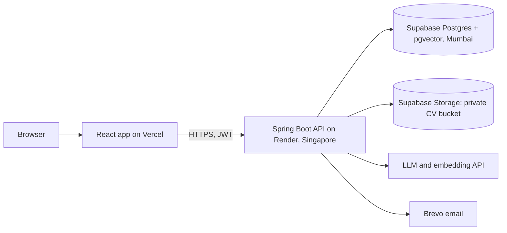

# Avrit Backend

**Avrit** = *Avsar* (opportunity) + *Vritti* (profession): a multi-company, AI-powered Applicant Tracking System.

[](https://github.com/Aareen098/avrit-backend/actions)


**Live app:** https://avrit.co.in · **API health:** https://hireflow-backend-pyx3.onrender.com/api/public/health


## What it does
- **Multi-company (multi-tenant):** every company has its own jobs, candidates and team. The company id is read only from the signed-in user's JWT, never from the request.
- **Roles:** Admin, Recruiter, Hiring Manager, Candidate.
- **Hiring pipeline:** public job pages, applications with CV upload, stage changes, interview scheduling, email notifications.
- **AI screening:** an LLM scores each candidate against the job and explains why.
- **Semantic CV search:** CVs are split into chunks and embedded (pgvector), so recruiters can search by meaning.
- **Platform admin:** usage metering, plans (Free/Pro/Business), monthly invoices, broadcasts. The platform owner sees usage and billing only, never company data.
- **Dashboard API:** one server-side summary endpoint for stats, skills and top matches.

## Architecture



## Tech stack
Java 21, Spring Boot 3.5, Spring Security (JWT), Spring Data JPA, PostgreSQL + pgvector, Supabase Storage, Brevo, Docker, GitHub Actions, JUnit + Mockito.

## Security highlights
- Tenant isolation from the JWT, with queries always scoped by company.
- Row Level Security enabled on every table (blocks the public database API).
- CV files in a private bucket, reachable only through the backend.
- Secrets only in environment variables, never in the repo.

## Run locally

```bash
cp .env.example .env  
docker compose up --build
```
Then open http://localhost:8080/api/public/health.
Without Docker: `./mvnw spring-boot:run`. Tests: `./mvnw test`.

## Configuration (environment variables)

| Variable | Purpose |
|---|---|
| `DB_URL`, `DB_USER`, `DB_PASSWORD` | Postgres connection (Supabase session pooler) |
| `JWT_SECRET` | Token signing key |
| `LLM_BASE_URL`, `LLM_API_KEY`, `LLM_MODEL` | AI screening model |
| `EMBED_MODEL`, `EMBED_ASYMMETRIC` | CV embeddings |
| `SUPABASE_URL`, `SUPABASE_SECRET_KEY` | CV file storage |
| `BREVO_API_KEY`, `MAIL_FROM`, `MAIL_FROM_NAME`, `MAIL_DAILY_LIMIT` | Email |
| `GOOGLE_CLIENT_ID` | Google sign-in |
| `MASTER_ADMIN_EMAIL` | Platform owner account |
| `CORS_ORIGIN` | Frontend URL (also used in email links) |

## Database setup
Tables are created automatically on first start. Then run once in the SQL editor:
`create extension if not exists vector;` and the script in `sql/semantic-search.sql`, then enable RLS on all tables.

## CI/CD
GitHub Actions runs the tests and builds the Docker image on every push.

## API
Base path `/api`. Public: `/public/jobs`, `/public/companies/{slug}/jobs`, `/public/health`. Everything else requires a JWT.

## Roadmap
Plan-limit enforcement, live notifications (SSE), more AI evaluation criteria.

## Author
**Aareen Anand**: MCA, Lovely Professional University · [GitHub](https://github.com/Aareen098)