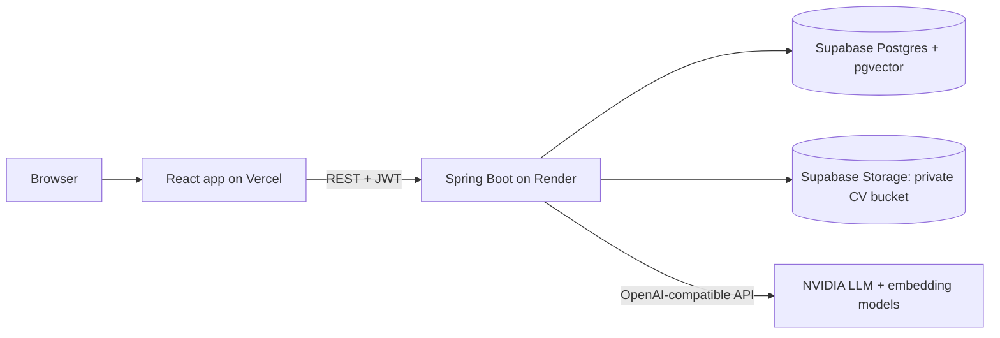

# HireFlow: AI-powered hiring platform (backend)

Spring Boot REST API for a multi-company ATS with AI CV screening and semantic search (RAG).

**Live app:** https://hireflow-frontend-theta.vercel.app/
**Frontend repo:** https://github.com/Aareen098/hireflow-frontend

## Architecture

## Highlights
- **Multi-tenancy:** shared database with a `company_id`. The company comes only from the JWT, never from the request, and other companies' records return 404.
- **Security:** stateless JWT, role-based access (`@PreAuthorize`), private CV storage, CV text treated as untrusted input for the LLM.
- **AI CV screening:** CV text is read with Apache Tika and scored by an LLM (structured JSON output).
- **RAG search:** CVs are split into chunks, embedded, stored in pgvector, and retrieved with vector + keyword search merged by reciprocal rank fusion. The assistant answers only from retrieved CV excerpts.
- **CI/CD:** GitHub Actions builds the jar and the Docker image; Render deploys after checks pass.

## Tech
Java 21, Spring Boot 3.5, Spring Security, JPA/Hibernate, PostgreSQL (Supabase) + pgvector, Docker, GitHub Actions, Render.

## Run locally
1. Copy `.env.example` to `.env` and fill in your values (see list below).
2. `./mvnw spring-boot:run`

| Variable | Purpose |
|---|---|
| `DB_URL`, `DB_USER`, `DB_PASSWORD` | Postgres connection |
| `JWT_SECRET` | token signing secret |
| `CORS_ORIGIN` | allowed frontend address |
| `LLM_API_KEY`, `LLM_MODEL`, `EMBED_MODEL` | AI models |
| `SUPABASE_URL`, `SUPABASE_SECRET_KEY`, `SUPABASE_BUCKET` | CV storage (leave empty to use a local folder) |
| `SEED_DEMO` | `true` creates demo accounts and sample jobs |

## Demo logins (sample company "Acme")
`admin@hireflow.com`, `recruiter@hireflow.com`, `manager@hireflow.com`, `candidate@hireflow.com`, all with password `password123`.